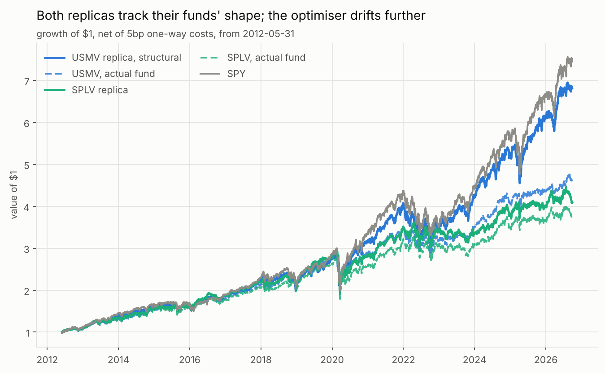
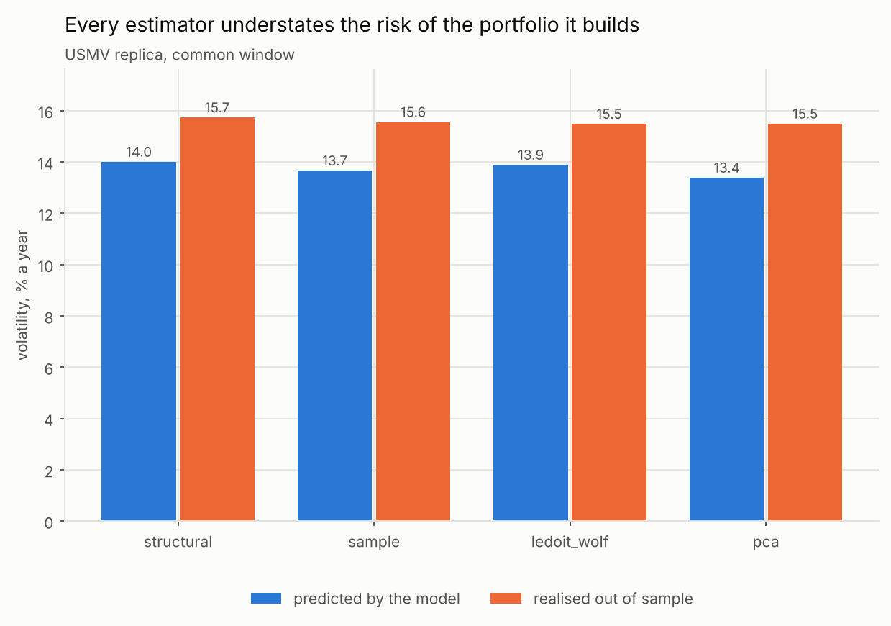
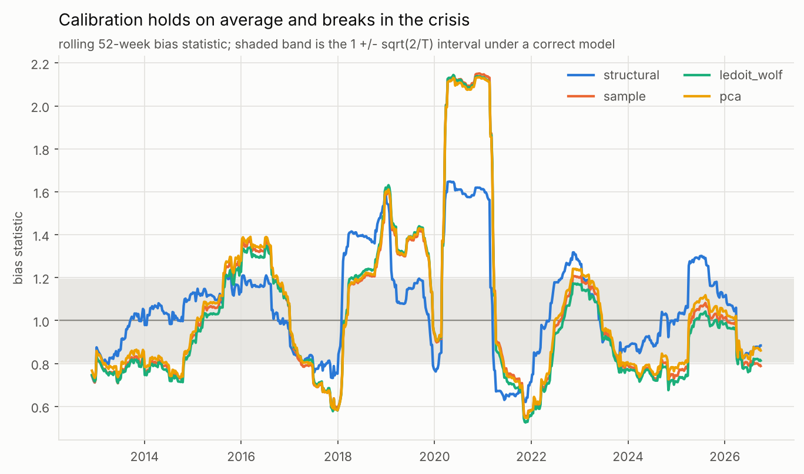
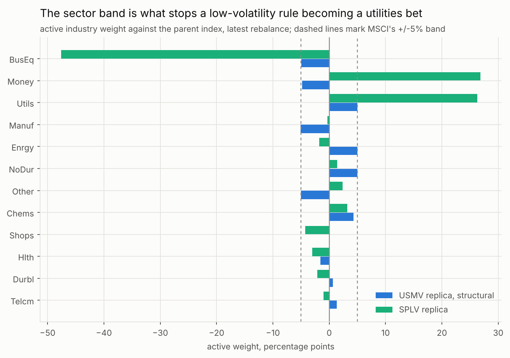
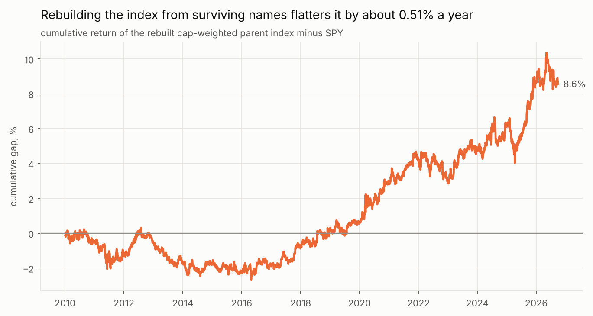

# Optimiser versus heuristic

## Replicating USMV and SPLV with a public-data factor risk model

Sample 2 January 2008 to 30 September 2026. Replication from 31 May 2012
(USMV) and 20 May 2011 (SPLV). All figures net of 5bp one-way trading costs
unless stated.

---

## 1. The question

USMV and SPLV both sell low volatility. They disagree completely about how to
get it.

MSCI builds the index behind USMV by feeding a commercial Barra risk model into
a constrained optimiser: minimise portfolio variance subject to a 1.5% position
cap, a 0.05% minimum holding, sector weights within 5 points of the parent,
style exposures within a quarter of a standard deviation of the parent on
everything except volatility, and one-way turnover under 10%. S&P builds the
index behind SPLV by ranking the S&P 500 on trailing one-year volatility,
keeping the hundred quietest names and weighting them by one over sigma.

So: how much of the optimiser's output can a risk model built entirely from free
data reproduce, and does the optimiser deliver lower realised risk than the
one-line rule?

## 2. What the replication achieves

| Replica | Tracking error | Correlation | Beta to target | Replica vol | Fund vol |
|---|---|---|---|---|---|
| SPLV | **1.62%** | 0.9939 | 0.967 | 14.06% | 14.46% |
| USMV, beta free | **3.73%** | 0.9637 | 1.001 | 13.97% | 13.45% |
| USMV, Ledoit-Wolf | 5.57% | 0.9353 | 1.077 | 15.49% | 13.45% |
| USMV, PCA | 5.73% | 0.9313 | 1.072 | 15.49% | 13.45% |
| USMV, sample | 5.77% | 0.9310 | 1.076 | 15.56% | 13.45% |
| USMV, structural | 5.83% | 0.9320 | 1.090 | 15.73% | 13.45% |

The heuristic replicates three and a half times more closely than the optimiser.
That ordering is not a verdict on the two methods. SPLV needs one number per
stock, trailing realised volatility, and free data supplies it exactly. USMV
needs a covariance matrix over a universe we do not have, estimated by a model
we cannot see, with an industry scheme we cannot license. The replication gap
measures the inputs, not the arithmetic.

## 3. One ambiguous sentence worth two points of tracking error

The 2012 methodology says no constraint applies to "the Barra Volatility risk
index factor", singular. The February 2025 document says the same thing about
"the Barra Volatility risk factors (BETA and RESVOL)", plural, because the USE4
model split what USE3 had combined. The sentence is identical in intent and
describes two different constraint sets.

Running both settles it:

| | Beta tilt | TE vs USMV | Replica vol | Beta to USMV | BAB loading |
|---|---|---|---|---|---|
| Residual volatility free only | -0.248 | 5.83% | 15.73% | 1.090 | 0.099 |
| Beta and residual volatility free | **-0.718** | **3.73%** | **13.97%** | **1.001** | **0.241** |
| USMV, the actual fund | n/a | n/a | 13.45% | 1.000 | 0.309 |

With beta bounded, the optimiser pins it against the band at -0.248 and stops;
the band, not the objective, is deciding the portfolio. Free it and beta runs to
-0.718, almost three times the band. The replica's volatility falls from 15.73%
to 13.97% against the fund's 13.45%, its beta to the fund goes from 1.090 to
1.001, and its betting-against-beta loading moves from 0.099 toward the fund's
0.309.

The live index behaves like the plural reading. A constrained minimum-variance
portfolio that may not lower its beta has been denied the most direct route to
low volatility there is, and it shows up in every statistic at once. Both
specifications are kept in the repository; the beta-free one is the better
description of the fund.

## 4. Which covariance estimator helps

Four estimators, same window, same names, same constraint set, so the only thing
differing is method.

| Estimator | Realised vol | Predicted vol | Predicted / realised | Turnover | Holdings | Relaxed |
|---|---|---|---|---|---|---|
| Structural factor model | 15.73% | 14.01% | 0.890 | 12.8% | 109 | 2 |
| Sample | 15.56% | 13.66% | 0.878 | 12.9% | 82 | 6 |
| Ledoit-Wolf | 15.49% | 13.89% | 0.897 | 13.9% | 81 | 5 |
| PCA (Bai-Ng) | 15.49% | 13.39% | 0.864 | 14.1% | 84 | 7 |

Realised volatility spans 24 basis points across the four. On the question the
optimiser exists to answer, the sophisticated estimator and the naive one are
indistinguishable.

Two things do separate them. The structural model needs fewer constraint
relaxations (2 rebalances against 5 to 7) and holds a third more names, so it
produces a portfolio an index provider could more plausibly publish. And every
estimator understates the risk of the portfolio it builds, by 10% to 14%.

That last row is not a rounding artefact. It is the signature of optimisation
against an estimated covariance: the optimiser seeks out whichever directions
the model believes are quietest, and those are disproportionately the directions
where the estimate is too low. Shrinkage helps (Ledoit-Wolf is closest to one at
0.897) and does not fix it.

## 5. Are the risk forecasts calibrated?

The bias statistic standardises each week's realised portfolio return by the
volatility the model predicted beforehand. A correct model gives one. With 769
weekly observations the 95% band is 1 plus or minus 0.051.

| Estimator | Random portfolios | Factor-mimicking | Minimum-variance |
|---|---|---|---|
| Structural | **1.000** (100% in band) | 0.939 (37%) | 1.078 (0%) |
| Sample | 1.027 (96%) | 1.051 (68%) | 1.090 (0%) |
| Ledoit-Wolf | 1.028 (95%) | 1.183 (5%) | 1.081 (0%) |
| PCA | 1.026 (96%) | 1.302 (11%) | 1.104 (0%) |

Read across the rows and the estimators separate sharply, which the realised
volatility table could not do. On generic long-only portfolios the structural
model is almost exactly calibrated, with every one of its hundred random
portfolios inside the band. On the factor-mimicking portfolios, which probe the
factor block directly, the statistical estimators fail badly: PCA understates
factor risk by 30%, because a handful of principal components cannot span
nineteen economically distinct factors and whatever they miss is booked as
diversifiable when it is not.

On the minimum-variance portfolios every estimator fails, and that is the
column that matters, because it is the portfolio the index actually holds.

### The crisis

A full-sample statistic near one hides a model that is too confident in calm
periods and too confident in a crash. Rolling through 2020:

| Quarter end | Structural, min-var | Sample | Ledoit-Wolf | PCA |
|---|---|---|---|---|
| 2020-03-31 | 1.60 | 2.01 | 2.00 | 2.00 |
| 2020-06-30 | 1.61 | 2.12 | 2.12 | 2.10 |
| 2020-12-31 | 1.61 | 2.15 | 2.13 | 2.13 |

Every model understated risk by a factor of roughly two through the pandemic,
which is what a correlation estimated over several years does when it is still
describing a pre-pandemic world in February 2020. The structural model was less
wrong, at 1.60 against 2.00, and the reason is the two-half-life construction:
volatilities use a 17-week memory and react, while correlations use 50 weeks and
stay precise. The sample, shrunk and PCA estimators all weight every week in
their 156-week window equally, and in a regime break that is exactly the wrong
thing to do.

## 6. Where the risk comes from, and what the constraints buy

| Portfolio | Holdings | Max weight | Effective N | Max active sector weight |
|---|---|---|---|---|
| USMV replica, structural | 88 | 2.0% | 68 | **5.0%** |
| USMV replica, beta free | 74 | 2.8% | 61 | 5.0% |
| SPLV replica | 100 | 1.3% | 99 | **40.7%** |

SPLV looks like the better diversified portfolio by every position-level
measure. It holds more names, its largest holding is smaller, and its effective
N of 99 out of 100 is near perfect equal weighting.

It is also making an enormous sector bet. At the latest rebalance the SPLV
replica is 27 points overweight financials, 26 points overweight utilities and
47 points underweight technology. MSCI's band holds its portfolio to 5 points
everywhere, eight times tighter.

This is the clearest answer the study produces to what the machinery buys.
Ranking on total volatility with no sector constraint does not spread risk
thoughtfully across the market; it finds whichever industries happened to be
quiet and sits on them. The concentration is invisible in a weight list, where
SPLV looks like the more diversified of the two, and obvious the moment weights
are aggregated by industry. Whether a 27-point financials overweight is a
feature or a hidden bet is a question for the holder. It is not an accident of
the rule, it is the rule.

## 7. Is low volatility an anomaly?

Regress each portfolio's excess return on the Fama-French five factors plus
momentum, then add betting-against-beta. Newey-West standard errors.

| Portfolio | Alpha, FF5+MOM | t | Alpha, +BAB | t | BAB loading | t |
|---|---|---|---|---|---|---|
| USMV, actual fund | -0.17% | -0.10 | -1.96% | -1.45 | 0.309 | 12.2 |
| SPLV, actual fund | -1.19% | -0.56 | -3.35% | -1.95 | 0.472 | 14.0 |
| USMV replica, beta free | +0.34% | 0.28 | -0.84% | -0.80 | 0.241 | 13.6 |
| USMV replica, structural | -0.07% | -0.09 | -0.54% | -0.71 | 0.099 | 10.3 |
| SPLV replica | -0.48% | -0.24 | -2.50% | -1.51 | 0.448 | 14.0 |

No portfolio here, real or replicated, has a statistically significant
intercept against the six-factor model. The largest t-statistic in the first
column is 1.09. Whatever low volatility earned over this period, the standard
factors already account for it, and there is no anomaly left to explain before
BAB is even introduced.

BAB then loads heavily and with t-statistics between 8.7 and 14.0 everywhere,
and the intercepts move further negative. The Frazzini-Pedersen reading fits:
these portfolios are long low-beta stocks, that exposure is what BAB is, and
once it is priced the residual return is slightly negative rather than
mysteriously positive.

Two cautions. The intercepts are negative but insignificant, so the honest
statement is that they are indistinguishable from zero, not that low volatility
destroyed value. And the sample runs from 2012 to 2026, a period containing one
long bull market and two short crashes, which is not enough to settle a question
the literature has been arguing about for forty years. What this says is that
these funds' returns over this window are explained by known factors. It does
not say the low-volatility effect is or is not real.

## 8. What the free data costs

### Survivorship

Of 899 tickers that passed through the S&P 500 between 2008 and 2026, 618 have
usable price history. 242 return nothing from Yahoo at all, at a steady rate of
about thirteen a year for nineteen years, which is simply index turnover: those
companies were acquired, went private or failed.

Rebuilding the cap-weighted parent index from the survivors and comparing it
with SPY prices the damage. Over 2010 to 2026 the rebuilt index tracks SPY at
1.50% annualised error with 0.9962 correlation and near-identical volatility
(17.15% against 17.05%), and it beats SPY by 0.51% a year. The sign is the one
survivorship bias predicts: the companies that failed are the ones missing, so
what remains looks better than the index did. Part of that half point is SPY's
own expense ratio working the other way, so 0.4% to 0.5% a year is the usable
estimate.

### Ticker reuse

Thirty-three tickers in this sample belong to a different company now than when
they were index members. `FB` left with Facebook's renaming in 2022 and was
reissued in 2025. `EMC` left on Dell's acquisition in 2016 and reappeared in
2023. `JAVA` was Sun Microsystems until 2010 and now belongs to someone else.
Joined on the ticker alone, each one silently grafts an unrelated company's
returns onto a historical constituent, and nothing in the pipeline complains.

### Filer errors inside EDGAR

Two distinct kinds, both of which reach the market cap panel if nothing stops
them.

Isolated mistyped facts: Yum Brands tagged 3.67e14 shares on its October 2016
10-Q against an actual count near 3.5e8, and Garmin tagged 1.98e11 the same
month. A rolling median over neighbouring filings catches these, and 1,442 facts
were removed that way.

Repeated scale errors are harder. AIG's Q2 2009 filing carries 1.35e14 shares in
every tag it uses, against an actual count near 1.35e9. Simon Property reported
2.93e11 where the truth was 2.93e8. Every neighbour agrees with the error, so
the median moves with it and sees nothing wrong. Left in, AIG alone gave the
October 2009 cross-section a single stock worth 4,548 trillion dollars and the
rebuilt parent index for that quarter was effectively that one name. A second
filter comparing each market cap against the day's cross-sectional median
removed 1,661 cells across 14 tickers.

### Coverage that could not be recovered

Four current index members have no usable consolidated share count, because they
are dual-class filers whose counts EDGAR publishes only with a class dimension
that the company-facts endpoint does not return: Berkshire Hathaway, Visa,
Constellation Brands and Erie Indemnity. Berkshire's last consolidated figure is
from 2015. Carrying a nine-year-old share count forward would misweight the
largest financial in the index, so a staleness rule drops it instead. Coverage
is 99.2% of index members by count at the end of 2024, and the missing names are
roughly 3% by weight.

## 9. How binding are MSCI's published rules?

The turnover cap binds at essentially every rebalance. Mean realised one-way
turnover is 12.8% to 14.1% against a 10% cap, the excess coming from rebalances
where the ladder had to be climbed.

Across 29 rebalances the published constraint set was infeasible on 2 dates
under the structural model and on 5 to 7 dates under the other three. November
2025 was the worst: it needed turnover at 30%, the minimum holding down to
0.01%, and the weight cap at 3%, which is rung 9 of MSCI's 13-rung ladder. No
date exhausted the ladder, so the carry-forward rule never had to fire.

Two implementation notes that materially change these numbers. MSCI measures
turnover against the existing index *drifted to the rebalance date*, not against
the target set six months earlier; constraining the wrong one understated
turnover and let the cap bind on a quantity the index never trades. And the
covariance matrix is dated to the end of the prior month, so the May review uses
end-April data. Both are in the published methodology and both were wrong in the
first implementation here.

## 10. Limitations

The ones that would change conclusions, in order of size.

**The parent universe is wrong.** MSCI optimises over the MSCI USA Investable
Market Index, roughly 2,500 names. This uses the S&P 500. No amount of care
elsewhere fixes that, and it is the largest single contributor to the USMV
tracking error.

**The risk model is not Barra's.** Six style factors against USE4's ten, twelve
SIC-derived industries against GICS's sectors, weekly rather than daily factor
returns, and no eigenfactor adjustment. The structural model is Barra-shaped,
not Barra.

**Industries are SIC-derived.** Coarser and older than GICS, and EDGAR publishes
one current code per filer rather than a history, so a company that changed
business carries today's code backwards.

**One parameter is unverified.** The S&P methodology PDF returned HTTP 403, so
the SPLV quarterly calendar and its third-Friday effective date come from the
published convention rather than from the document. Selection and weighting were
confirmed from Invesco's prospectus.

**The 5bp floor is handled heuristically.** Solve, drop sub-floor names,
re-solve. This is what index providers do, but it is not an exact mixed-integer
solve and the optimality gap is not measured here.

**Attribution windows differ from the price sample.** Ken French data ends
2026-08-31 and AQR's BAB ends 2026-07-31, so the regressions stop earlier than
the portfolio results. Each table states its own window.

## 11. What the study concludes

The optimiser does not deliver lower realised volatility than the heuristic
because of its covariance estimator. Four estimators spanning naive to
structural produced portfolios within 24 basis points of each other on realised
volatility, and all four understated their own risk by 10% to 14%.

What the optimiser delivers is control. The sector band holds active industry
weight to 5 points where the heuristic runs to 41. The style bands keep every
exposure except volatility near the parent. The turnover cap holds trading to
roughly a eighth of the book twice a year. None of that shows up as lower
volatility in this sample, and all of it shows up as a portfolio whose risk is
where its designer intended rather than wherever the last year's quietest
industry happened to be.

The sharpest single finding is narrower and more useful: which factors the style
exemption covers matters more than which covariance estimator sits underneath
it. Freeing beta cut tracking error from 5.83% to 3.73% and brought replica
volatility from 15.73% to within half a point of the fund. Choosing among
estimators moved it by 24 basis points. For anyone replicating a constrained
index, reading the constraint document carefully is worth more than a better
covariance matrix.

---

### Reproducing this

`make all` from a clean checkout. Fifteen to twenty minutes for the data, under
ten for everything else. No API key, subscription or login. Sources, access
dates and redistribution status are in `references/source_register.csv`;
parameters and their provenance are in `config/params.yaml`.
